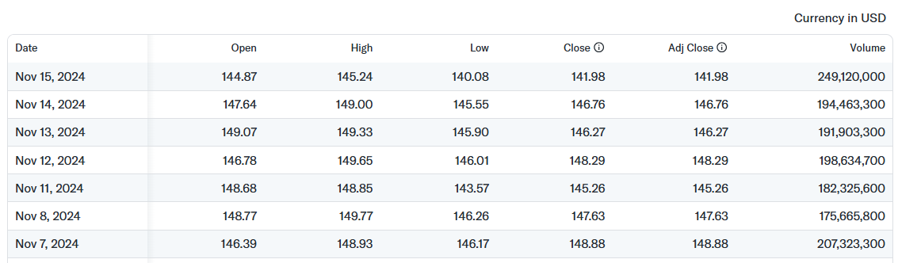
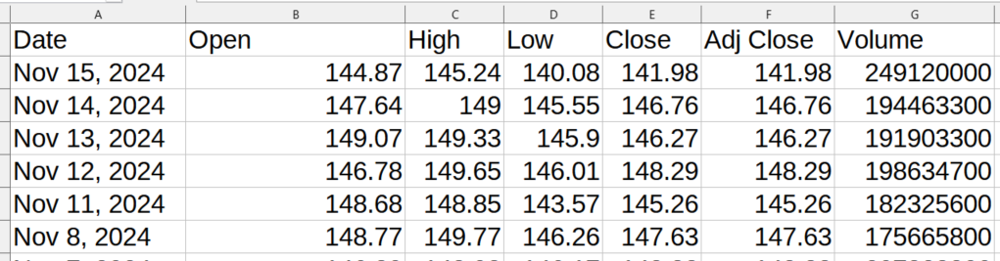
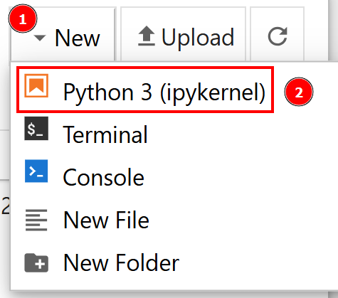
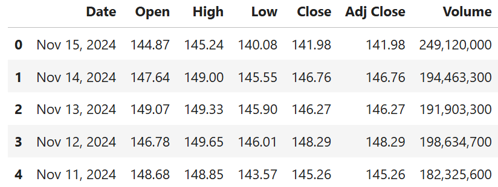
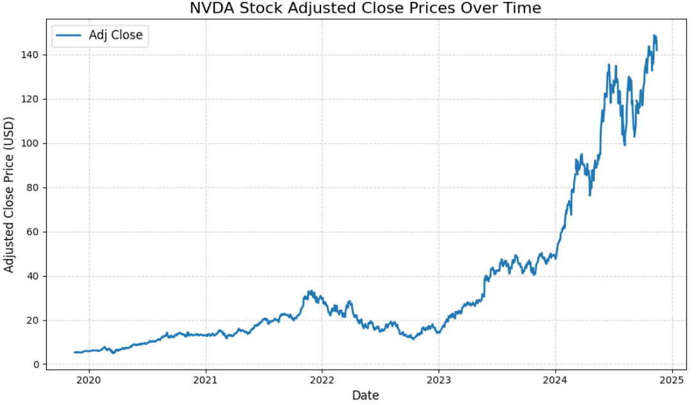
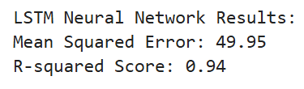
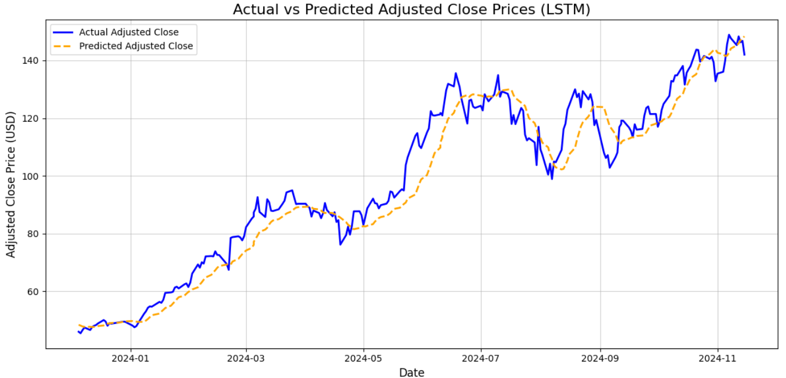

# 用于机器学习的网页爬虫

[](https://www.bright.cn/) 

本指南介绍如何为机器学习项目采集、准备和使用网页抓取的数据，包括 [ETL](https://www.bright.cn/blog/proxy-101/etl-pipeline) 设置和模型训练技巧。在继续之前，建议你先进一步熟悉使用 Python 进行网页爬虫。 

- [为机器学习执行数据抓取](#为机器学习执行数据抓取)
- [对抓取的数据应用机器学习](#对抓取的数据应用机器学习)
- [拟合 LSTM 神经网络的注意事项](#拟合-lstm-神经网络的注意事项)
- [为机器学习抓取数据时设置 ETL](#为机器学习抓取数据时设置-etl)

## 什么是机器学习？

机器学习（ML）是 AI 的一个分支，它使系统无需显式编程即可从数据中学习。机器学习应用数学模型识别数据中的模式，让计算机能够根据新输入进行预测。

## 为什么网页爬虫对机器学习很有用

机器学习和 AI 系统依靠数据训练模型，因此网页爬虫是数据专业人员非常有价值的工具。以下是网页爬虫对 ML 有用的原因：

- **大规模数据采集**：ML 模型，尤其是深度学习模型，需要海量数据集。网页爬虫能够实现大规模数据采集。
- **多样且丰富的数据源**：网络提供各种各样的数据，可丰富现有数据集，从而更好地训练模型。
- **最新信息**：对于需要掌握最新趋势的模型（例如股票预测和情感分析），网页爬虫可确保数据保持最新。
- **提升模型性能**：更多数据有助于提高模型的准确性和验证效果，使网页爬虫成为一项关键资源。
- **市场分析**：提取评论、评分和趋势有助于开展消费者情感分析并获取商业洞察。

## 指南前提条件

要按照本指南操作，你的系统需要满足以下前提条件：

- Python 3.6 或更高版本
- Jupyter Notebook 6.x
- IDE，例如 VS Code

## 为机器学习执行数据抓取

本节将分步介绍如何抓取 Yahoo Finance，获取 NVIDIA 股票价格以用于机器学习。

### 第 1 步：设置环境

创建一个包含以下子文件夹的存储库：`data`、`notebooks` 和 `scripts`。

```
scraping_project/
├── data/
│   └── ...
├── notebooks/
│   └── analysis.ipynb
├── scripts/
│   └── data_retrieval.py
└── venv/
```

在本项目中：

- `data_retrieval.py` 将包含你的抓取逻辑。
- `analysis.ipynb` 将包含机器学习逻辑。
- `data/` 将包含通过机器学习进行分析的抓取数据。

创建虚拟环境：

```bash
python3 -m venv venv 
```

要在 Windows 上激活它，请运行：

```powershell
venv\Scripts\activate
```

在 macOS/Linux 上，请执行：

```bash
source venv/bin/activate
```

安装所需的库：

```bash
pip install selenium requests pandas matplotlib scikit-learn tensorflow notebook
```

### 第 2 步：确定目标页面

要获取 NVIDIA 的历史数据，你必须访问以下 URL：

```
https://finance.yahoo.com/quote/NVDA/history/
```

该页面提供了用于定义数据展示方式的筛选器：


为了获取足够的机器学习数据，你可以将时间范围筛选为 5 年。你可以使用以下包含该筛选条件的 URL：

```
https://finance.yahoo.com/quote/NVDA/history/?frequency=1d&period1=1574082848&period2=1731931014
```

现在，你需要定位下表并从中检索数据：



定义该表格的 CSS 选择器是 `.table`，因此你可以在 `data_retrieval.py` 文件中编写以下代码：

```python
from selenium import webdriver
from selenium.webdriver.chrome.service import Service
from selenium.webdriver.support.ui import WebDriverWait
from selenium.webdriver.support import expected_conditions as EC
from selenium.webdriver.common.by import By
from selenium.common import NoSuchElementException
import pandas as pd
import os

# Configure Selenium
driver = webdriver.Chrome(service=Service())

# Target URL
url = "https://finance.yahoo.com/quote/NVDA/history/?frequency=1d&period1=1574082848&period2=1731931014"
driver.get(url)

# Wait for the table to load
try:
    WebDriverWait(driver, 20).until(
        EC.presence_of_element_located((By.CSS_SELECTOR, ".table"))
    )
except NoSuchElementException:
    print("The table was not found, verify the HTML structure.")
    driver.quit()
    exit()

# Locate the table and extract its rows
table = driver.find_element(By.CSS_SELECTOR, ".table")
rows = table.find_elements(By.TAG_NAME, "tr")
```

上述代码片段执行以下操作：

- 设置 Selenium Chrome 驱动程序实例
- 定义目标 URL，并指示 Selenium 访问该 URL
- 等待表格加载：在本例中，目标表格由 Javascript 加载，因此网页驱动程序会等待 20 秒，以确保表格完成加载
- 使用专用的 CSS 选择器获取整个表格

### 第 3 步：检索数据并将其保存到 CSV 文件

现在，你需要从表格中提取表头、检索表格中的所有数据，并将数据转换为 [NumPy 数据帧](https://pandas.pydata.org/docs/reference/api/pandas.DataFrame.to_numpy.html)。

你可以使用以下代码执行此操作：

```python
# Extract headers from the first row of the table
headers = [header.text for header in rows[0].find_elements(By.TAG_NAME, "th")]

# Extract data from the subsequent rows
data = []
for row in rows[1:]:
    cols = [col.text for col in row.find_elements(By.TAG_NAME, "td")]
    if cols:
        data.append(cols)

# Convert data into a pandas DataFrame
df = pd.DataFrame(data, columns=headers)
```

### 第 4 步：将 CSV 文件保存到 `data/` 文件夹

脚本生成的 CSV 文件必须保存到 `data/` 文件夹。代码如下：

```python
# Determine the path to save the CSV file
current_dir = os.path.dirname(os.path.abspath(__file__))  

# Navigate to the "data/" directory
data_dir = os.path.join(current_dir, "../data") 

# Ensure the directory exists 
os.makedirs(data_dir, exist_ok=True)  

# Full path to the CSV file
csv_path = os.path.join(data_dir, "nvda_stock_data.csv")  

# Save the DataFrame to the CSV file
df.to_csv(csv_path, index=False)
print(f"Historical stock data saved to {csv_path}")

# Close the WebDriver
driver.quit()
```

此代码使用 `os.path.dirname()` 方法确定当前路径（绝对路径），通过 `os.path.join()` 方法导航到 `data/` 文件夹，使用 `os.makedirs(data_dir, exist_ok=True)` 方法确保该文件夹存在，调用 Pandas 库中的 `df.to_csv()` 方法将数据保存到 CSV 文件，最后退出驱动程序。

### 第 5 步：整合所有代码

以下是 `data_retrieval.py` 文件的完整代码：

```python
from selenium import webdriver
from selenium.webdriver.chrome.service import Service
from selenium.webdriver.support.ui import WebDriverWait
from selenium.webdriver.support import expected_conditions as EC
from selenium.webdriver.common.by import By
from selenium.common import NoSuchElementException
import pandas as pd
import os

# Configure Selenium
driver = webdriver.Chrome(service=Service())

# Target URL
url = "https://finance.yahoo.com/quote/NVDA/history/?frequency=1d&period1=1574082848&period2=1731931014"
driver.get(url)

# Wait for the table to load
try:
    WebDriverWait(driver, 5).until(
        EC.presence_of_element_located((By.CSS_SELECTOR, "table.table.yf-j5d1ld.noDl"))
    )
except NoSuchElementException:
    print("The table was not found, verify the HTML structure.")
    driver.quit()
    exit()

# Locate the table and extract its rows
table = driver.find_element(By.CSS_SELECTOR, ".table")
rows = table.find_elements(By.TAG_NAME, "tr")

# Extract headers from the first row of the table
headers = [header.text for header in rows[0].find_elements(By.TAG_NAME, "th")]

# Extract data from the subsequent rows
data = []
for row in rows[1:]:
    cols = [col.text for col in row.find_elements(By.TAG_NAME, "td")]
    if cols:
        data.append(cols)

# Convert data into a pandas DataFrame
df = pd.DataFrame(data, columns=headers)

# Determine the path to save the CSV file
current_dir = os.path.dirname(os.path.abspath(__file__))  

# Navigate to the "data/" directory
data_dir = os.path.join(current_dir, "../data") 

# Ensure the directory exists 
os.makedirs(data_dir, exist_ok=True)

# Full path to the CSV file  
csv_path = os.path.join(data_dir, "nvda_stock_data.csv")

# Save the DataFrame to the CSV file
df.to_csv(csv_path, index=False)
print(f"Historical stock data saved to {csv_path}")

# Close the WebDriver
driver.quit()
```

在 Windows 上，使用以下命令启动上述脚本：

```powershell
python data_retrieval.py
```

在 Linux/macOS 上：

```bash
python3 data_retrieval.py
```

抓取后的输出数据如下所示：



## 对抓取的数据应用机器学习

接下来，我们使用 CSV 文件中的数据进行机器学习预测。

### 第 1 步：创建新的 Jupyter Notebook 文件

从主文件夹导航到 `notebooks/` 文件夹：

```bash
cd notebooks 
```

打开 Jupyter Notebook：

```bash
jupyter notebook
```

浏览器打开后，点击 **New > Python3 (ipykernel)**，创建新的 Jupyter Notebook 文件：



将文件重命名为 `analysis.ipynb`。

### 第 2 步：打开 CSV 文件并显示前几行

现在，你可以打开包含数据的 CSV 文件，并显示数据帧的前几行：

```python
import pandas as pd

# Path to the CSV file
csv_path = "../data/nvda_stock_data.csv"

# Open the CVS file
df = pd.read_csv(csv_path)

# Show head
df.head()
```

此代码使用 `csv_path = "../data/nvda_stock_data.csv"` 进入 `data/` 文件夹。然后，它通过 [`pd.read_csv()`](https://pandas.pydata.org/docs/reference/api/pandas.read_csv.html) 方法将 CSV 作为数据帧打开，并使用 [`df.head()`](https://pandas.pydata.org/docs/reference/api/pandas.DataFrame.head.html) 方法显示前几行（前 5 行）。

预期结果如下：



### 第 3 步：可视化 `Adj Close` 值随时间变化的趋势

数据帧正确加载后，你可以可视化 `Adj Close` 值的变化趋势，该值表示调整后的收盘价：

```python
import matplotlib.pyplot as plt

# Ensure the "Date" column is in datetime forma
df["Date"] = pd.to_datetime(df["Date"])

# Sort the data by date (if not already sorted)
df = df.sort_values(by="Date")

# Plot the "Adj Close" values over time
plt.figure(figsize=(10, 6))
plt.plot(df["Date"], df["Adj Close"], label="Adj Close", linewidth=2)

# Customize the plot
plt.title("NVDA Stock Adjusted Close Prices Over Time", fontsize=16) # Sets title
plt.xlabel("Date", fontsize=12) # Sets x-axis label
plt.ylabel("Adjusted Close Price (USD)", fontsize=12) # Sets y-axis label
plt.grid(True, linestyle="--", alpha=0.6) # Defines styles of the line
plt.legend(fontsize=12) # Shows legend
plt.tight_layout()

# Show the plot
plt.show()
```

上述代码执行以下操作：

- `df["Date"]` 访问数据帧的 `Date` 列，并使用 `pd.to_datetime()` 方法确保日期采用日期格式
- `df.sort_values()` 对 `Date` 列中的日期进行排序，以确保数据按时间顺序显示。
- `plt.figure()` 设置图表尺寸，`plt.plot()` 则绘制图表
- `# Customize the plot` 注释下方的代码行用于自定义图表，包括设置标题、坐标轴标签和显示图例
- `plt.show()` 方法用于实际显示图表

预期结果如下所示：



该图表显示了 NVIDIA 股票调整后收盘价随时间变化的实际趋势。你将训练的机器学习模型需要尽可能准确地预测这些值。

### 第 3 步：为机器学习准备数据

接下来，对数据进行清理和准备：

```python
from sklearn.preprocessing import MinMaxScaler

# Convert data types
df["Volume"] = pd.to_numeric(df["Volume"].str.replace(",", ""), errors="coerce")
df["Open"] = pd.to_numeric(df["Open"].str.replace(",", ""), errors="coerce")

# Handle missing values 
df = df.infer_objects().interpolate() 

# Select the target variable ("Adj Close") and scale the data
scaler = MinMaxScaler(feature_range=(0, 1))  # Scale data between 0 and 1
data = scaler.fit_transform(df[["Adj Close"]])
```

上述代码执行以下操作：

- 使用 `to_numeric()` 方法转换 `Volume` 和 `Open` 值
- 使用 `interpolate()` 方法通过插值填充缺失值
- 使用 `MinMaxScaler()` 缩放数据
- 使用 `fit_transform()` 方法选择并转换（缩放）目标变量 `Adj Close`

### 第 4 步：创建训练集和测试集

本教程使用的模型是 LSTM（[长短期记忆网络](https://machinelearningmastery.com/gentle-introduction-long-short-term-memory-networks-experts/)），它属于 RNN（[循环神经网络](https://www.ibm.com/topics/recurrent-neural-networks)）。你需要创建一个时间步序列，让模型能够学习数据：

```python
import numpy as np

# Create sequences of 60 time steps for prediction
sequence_length = 60
X, y = [], []

for i in range(sequence_length, len(data)):
    X.append(data[i - sequence_length:i, 0])  # Last 60 days
    y.append(data[i, 0])  # Target value

X, y = np.array(X), np.array(y)

# Split into training and test sets
split_index = int(len(X) * 0.8)  # 80% training, 20% testing
X_train, X_test = X[:split_index], X[split_index:]
y_train, y_test = y[:split_index], y[split_index:]
```

上述代码片段：

- 创建包含 60 个时间步的序列。`X` 是特征数组，`y` 是目标值数组。
- 拆分初始数据帧：80% 作为训练集，20% 作为测试集。

### 第 5 步：训练模型

接下来，使用训练集训练 RNN：

```python
from tensorflow.keras.models import Sequential
from tensorflow.keras.layers import Dense, LSTM

# Reshape X for LSTM [samples, time steps, features]
X_train = X_train.reshape((X_train.shape[0], X_train.shape[1], 1))
X_test = X_test.reshape((X_test.shape[0], X_test.shape[1], 1))

# Build the Sequential Neural Network
model = Sequential()
model.add(LSTM(32, activation="relu", return_sequences=False))
model.add(Dense(1))
model.compile(loss="mean_squared_error", optimizer="adam")

# Train the Model
history = model.fit(X_train, y_train, epochs=20, batch_size=32, validation_data=(X_test, y_test), verbose=1)
```

此代码执行以下操作：

- 使用 `reshape()` 方法重塑特征数组，使训练集和测试集均符合 LSTM 神经网络的输入要求
- 通过设置参数构建 LSTM 神经网络
- 使用 `fit()` 方法在训练集上拟合 LSTM

换句话说，模型现已完成对训练集的拟合，可以开始进行预测。

### 第 6 步：进行预测并评估模型性能

接下来评估模型的性能：

```python
from sklearn.metrics import mean_squared_error, r2_score

# Make Predictions
y_pred = model.predict(X_test)

# Inverse scale predictions and actual values for comparison
y_test = scaler.inverse_transform(y_test.reshape(-1, 1))
y_pred = scaler.inverse_transform(y_pred)

# Evaluate the Model
mse = mean_squared_error(y_test, y_pred)
r2 = r2_score(y_test, y_pred)

# print results
print("\nLSTM Neural Network Results:")
print(f"Mean Squared Error: {mse:.2f}")
print(f"R-squared Score: {r2:.2f}")
```

此代码执行以下操作：

- 反转横轴上的值，以便之后按时间顺序展示数据。此操作通过 `inverse_transform()` 方法完成。
- 使用[均方误差](https://scikit-learn.org/1.5/modules/generated/sklearn.metrics.mean_squared_error.html)和 [R^2 分数](https://scikit-learn.org/dev/modules/generated/sklearn.metrics.r2_score.html)评估模型。

由于 ML 模型具有随机性，可能会出现统计误差。预期结果如下：



这些结果表明，该模型能够很好地预测 `Adj Close`。

### 第 7 步：使用图表比较实际值与预测值

仅使用机器学习比较结果并不总是足够。接下来创建一个图表，将 `Adj Close` 的实际值与 LSTM 模型的预测值进行比较：

```python
# Visualize the Results
test_results = pd.DataFrame({
    "Date": df["Date"].iloc[len(df) - len(y_test):],  # Test set dates
    "Actual": y_test.flatten(),
    "Predicted": y_pred.flatten()
})

# Setting plot
plt.figure(figsize=(12, 6))
plt.plot(test_results["Date"], test_results["Actual"], label="Actual Adjusted Close", color="blue", linewidth=2)
plt.plot(test_results["Date"], test_results["Predicted"], label="Predicted Adjusted Close", color="orange", linestyle="--", linewidth=2)
plt.title("Actual vs Predicted Adjusted Close Prices (LSTM)", fontsize=16)
plt.xlabel("Date", fontsize=12)
plt.ylabel("Adjusted Close Price (USD)", fontsize=12)
plt.legend()
plt.grid(alpha=0.6)
plt.tight_layout()
plt.show()
```

此代码：

- 在测试集层面比较实际值和预测值，因此必须裁剪实际值，使其形状与测试集一致。此操作通过 `iloc()` 和 `flatten()` 方法完成。
- 创建图表、添加坐标轴标签和标题，并管理其他设置以改善可视化效果。

预期结果如下所示：



如图所示，LSTM 神经网络的预测值（黄色虚线）与实际值（蓝色实线）非常接近。分析结果已经很理想，而可视化结果进一步验证了其准确性。

### 第 8 步：整合所有代码

以下是 `analysis.ipynb` Notebook 的完整代码：

```python
import numpy as np
import pandas as pd
import matplotlib.pyplot as plt
from sklearn.preprocessing import MinMaxScaler
from sklearn.metrics import mean_squared_error, r2_score
from tensorflow.keras.models import Sequential
from tensorflow.keras.layers import Dense, LSTM

# Path to the CSV file
csv_path = "../data/nvda_stock_data.csv"  
# Open CSV as data frame
df = pd.read_csv(csv_path)

# Convert "Date" to datetime format
df["Date"] = pd.to_datetime(df["Date"])

# Sort by date
df = df.sort_values(by="Date")

# Convert data types
df["Volume"] = pd.to_numeric(df["Volume"].str.replace(",", ""), errors="coerce")
df["Open"] = pd.to_numeric(df["Open"].str.replace(",", ""), errors="coerce")

# Handle missing values 
df = df.infer_objects().interpolate()

# Select the target variable ("Adj Close") and scale the data
scaler = MinMaxScaler(feature_range=(0, 1))  # Scale data between 0 and 1
data = scaler.fit_transform(df[["Adj Close"]])

# Prepare the Data for LSTM
# Create sequences of 60 time steps for prediction
sequence_length = 60
X, y = [], []

for i in range(sequence_length, len(data)):
    X.append(data[i - sequence_length:i, 0])  # Last 60 days
    y.append(data[i, 0])  # Target value

X, y = np.array(X), np.array(y)

# Split into training and test sets
split_index = int(len(X) * 0.8)  # 80% training, 20% testing
X_train, X_test = X[:split_index], X[split_index:]
y_train, y_test = y[:split_index], y[split_index:]

# Reshape X for LSTM [samples, time steps, features]
X_train = X_train.reshape((X_train.shape[0], X_train.shape[1], 1))
X_test = X_test.reshape((X_test.shape[0], X_test.shape[1], 1))

# Build the Sequential Neural Network
model = Sequential()
model.add(LSTM(32, activation="relu", return_sequences=False))
model.add(Dense(1))
model.compile(loss="mean_squared_error", optimizer="adam")

# Train the Model
history = model.fit(X_train, y_train, epochs=20, batch_size=32, validation_data=(X_test, y_test), verbose=1)

# Make Predictions
y_pred = model.predict(X_test)

# Inverse scale predictions and actual values for comparison
y_test = scaler.inverse_transform(y_test.reshape(-1, 1))
y_pred = scaler.inverse_transform(y_pred)

# Evaluate the Model
mse = mean_squared_error(y_test, y_pred)
r2 = r2_score(y_test, y_pred)

# Print results
print("\nLSTM Neural Network Results:")
print(f"Mean Squared Error: {mse:.2f}")
print(f"R-squared Score: {r2:.2f}")

# Visualize the Results
test_results = pd.DataFrame({
    "Date": df["Date"].iloc[len(df) - len(y_test):],  # Test set dates
    "Actual": y_test.flatten(),
    "Predicted": y_pred.flatten()
})

# Setting plot
plt.figure(figsize=(12, 6))
plt.plot(test_results["Date"], test_results["Actual"], label="Actual Adjusted Close", color="blue", linewidth=2)
plt.plot(test_results["Date"], test_results["Predicted"], label="Predicted Adjusted Close", color="orange", linestyle="--", linewidth=2)
plt.title("Actual vs Predicted Adjusted Close Prices (LSTM)", fontsize=16)
plt.xlabel("Date", fontsize=12)
plt.ylabel("Adjusted Close Price (USD)", fontsize=12)
plt.legend()
plt.grid(alpha=0.6)
plt.tight_layout()
plt.show()
```

此代码直接实现目标，跳过初始数据预览，并且仅绘制 `Adj Close` 值，因为前面的初步分析已经介绍过这些步骤。

> **注意**：
> 
> 虽然代码分成多个部分展示，但由于 ML 具有随机性，最好一次性运行完整代码；否则，最终图表可能会出现显著差异。

## 拟合 LSTM 神经网络的注意事项

为简单起见，本指南直接重点介绍如何拟合 LSTM 神经网络。然而，在实际 ML 应用中，该流程包含几个关键步骤：

1. **初步数据分析**。这是最关键的步骤，你需要了解数据、清理 NaN 值、处理重复项，并解决所有数学不一致问题。

2. **训练 ML 模型**。你尝试的第一个模型可能并不是最佳选择。常见方法是进行[快速评估](https://machinelearningmastery.com/spot-check-machine-learning-algorithms-in-python/)，其中包括：

   - 在训练集上训练 3–4 个 ML 模型并评估其性能。
   - 选择表现最好的 2–3 个模型，并[调整其超参数](https://scikit-learn.org/1.5/modules/grid_search.html)。
   - 在测试集上比较经过最佳调优的模型。
   - 选择性能最高的模型。

3. **部署**。随后，将性能最佳的模型部署到生产环境中。

## 为机器学习抓取数据时设置 ETL

将网页抓取的数据保存为 CSV 是机器学习中的常见做法，尤其是在项目初期寻找最佳预测模型时。  

确定最佳模型后，通常会设置一条 **ETL（提取、转换、加载）管道**，以自动完成数据检索、清理和存储。

以下是 ML 工作流中的 ETL 流程：

- **提取**：从包括网页爬虫在内的各种来源检索数据。  
- **转换**：清理和准备采集的数据。  
- **加载**：将处理后的数据存储到数据库或数据仓库中。  

存储完成后，数据将集成到 ML 工作流中，以使用新数据**重新训练并重新验证模型**。

## 总结

需要机器学习数据，但不熟悉网页爬虫？[查看我们的高效数据检索解决方案](https://www.bright.cn/ai)。  

注册免费的 Bright Data 账户，试用我们的爬虫工具 API 或探索我们的数据集。
